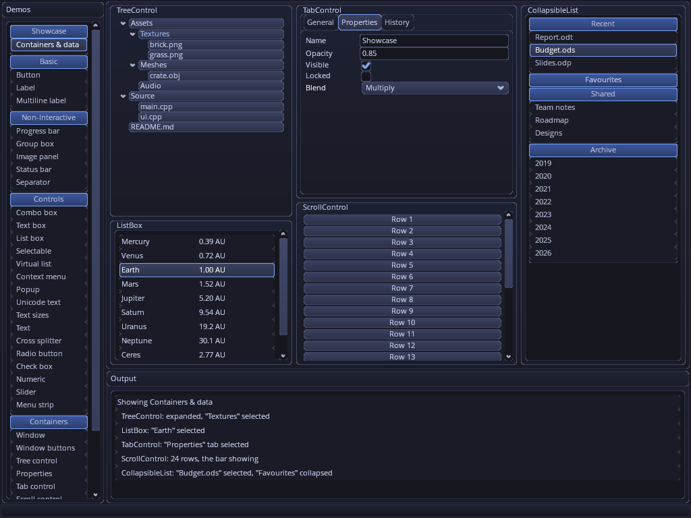
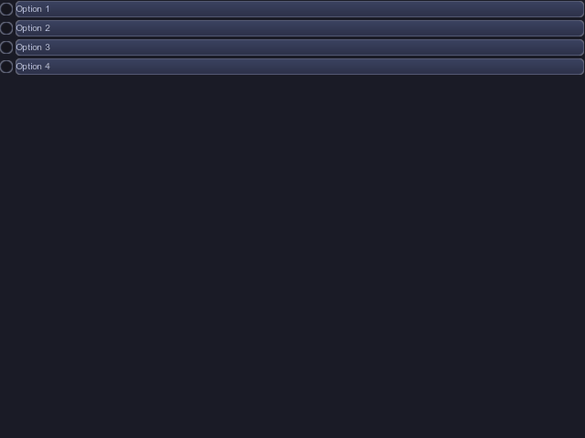
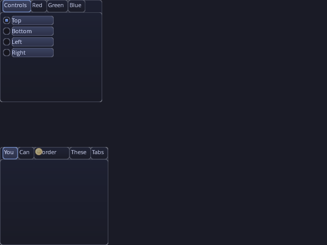
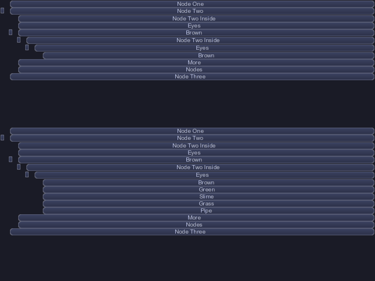
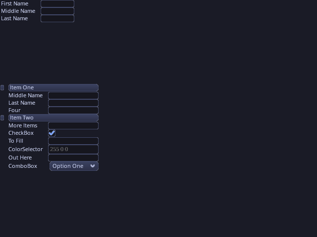
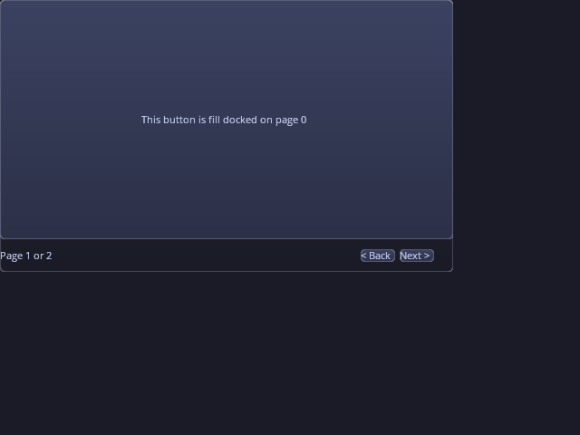

gweni - GUI Without Extravagant Nonsense (plus i for breaking changes)
---------------------

This is an attempt to make GWEN a more opengl aware ui. The expectation is to build it to provide better performance with the way modern opengl works (and later vulkan)

*The `OpenGLCore` demo on the OpenGL 3.0+ core renderer with the textured skin's Tokyo Night theme.*

## Goals

- **Rendering-API agnostic.** UI logic — layout, padding, docking, hover/highlight/focus,
  hit-testing — is decoupled from drawing. A backend just implements one interface
  (`gweni::renderer::Base`), so the same UI runs on OpenGL today and Vulkan (or others) later.
- **Two-phase frame.** `canvas->updateCanvas()` does the layout/display logic and records
  what changed; `canvas->renderCanvas()` issues only the draw-state changes needed.
- **Cost scales with change, not size.** Each control owns persistent renderer *primitive ids*
  that index into a large GPU buffer (VBO). Only primitives that changed are updated, and
  the intent is to upload just those regions to the GPU (or a larger contiguous span when
  that copy is faster), then render straight from the buffer. A simple backend may instead
  just redraw every control each frame.

See [docs/architecture.md](docs/architecture.md) for the full design and the current
implemented-vs-planned status, and [docs/layout.md](docs/layout.md) for the layout system.

## Samples

| | |
|---|---|
|  |  |
| **Button** | **RadioButton** |
|  |  |
| **TabControl** | **TreeControl** |
|  |  |
| **Properties** | **PageControl** |

Each control is shown on its own in `ControlTest`. All of these images are rendered offscreen by
`tools/capture_samples.sh` (see `AGENTS.md`).

---------------------------------------

GWEN was originaly created by Garry Newman, and released under MIT License.
https://github.com/garrynewman/GWEN