gweni - GUI Without Extravagant Nonsense (plus i for breaking changes)
---------------------

This is an attempt to make GWEN a more opengl aware ui. The expectation is to build it to provide better performance with the way modern opengl works (and later vulkan)

**[Try it live](https://caseymcc.github.io/gweni/)**: the demo and the control gallery, compiled to WebAssembly and drawn on
WebGL 2 by the same `OpenGLCore` renderer, in any recent desktop browser. Every image below links
to its live page.

[](https://caseymcc.github.io/gweni/demo.html?demo=ShowcaseContainersDemo)

*The `OpenGLCore` demo on the OpenGL 3.0+ core renderer with the textured skin's Tokyo Night theme, showing the Containers & data showcase page: a TreeControl, a ListBox, a TabControl with closable tabs holding a Properties grid, a ScrollControl, a CollapsibleList and a striped DataTable sorted by file name, with one row selected.*

## Goals

- **Rendering-API agnostic.** UI logic — layout, padding, docking, hover/highlight/focus,
  hit-testing — is decoupled from drawing. A backend just implements one interface
  (`gweni::renderer::Base`), so the same UI runs on OpenGL today and Vulkan (or others) later.
- **Two-phase frame.** `canvas->updateCanvas()` does the layout/display logic and records
  what changed; `canvas->renderCanvas()` issues only the draw-state changes needed.
- **Cost scales with change, not size.** Each control owns persistent renderer *primitive ids*
  that index into a large GPU buffer (VBO). Only primitives that changed are updated, and
  the intent is to upload just those regions to the GPU (or a larger contiguous span when
  that copy is faster), then render straight from the buffer. A simple backend may instead
  just redraw every control each frame.

See [docs/architecture.md](docs/architecture.md) for the full design and the current
implemented-vs-planned status, and [docs/layout.md](docs/layout.md) for the layout system.

### Future goals

- **Accessibility.** A UI drawn on a canvas, and above all the web build, is invisible to
  screen readers and other assistive technology. Mainstream toolkits expose a tree of their
  controls to the platform (Qt's QAccessible, Flutter's semantics tree, ARIA in the browser),
  and the goal is for gweni to mirror its control tree into the platform's accessibility API:
  on the web an off-screen ARIA/DOM tree, on desktop AT-SPI, UI Automation or NSAccessibility.
  The retained, change-tracked tree suits this: only the controls that changed would update
  their mirror nodes, so a settled frame would cost nothing.

## Samples

[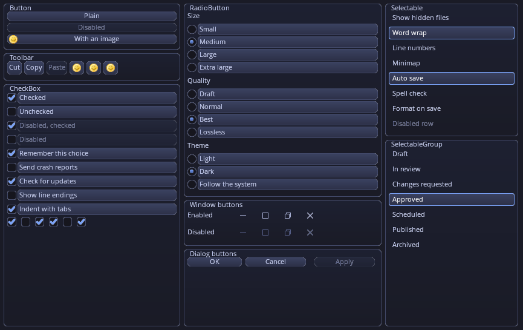](https://caseymcc.github.io/gweni/controltest.html?control=ShowcaseButtonsDemo)

**Buttons & toggles**: Buttons (disabled, with an image, a toolbar of icon-only ones, a dialog row),
CheckBoxes (checked, unchecked, disabled labels), three RadioButton groups, Selectable rows and a
single-selection SelectableGroup, and the window buttons (maximised, disabled).

[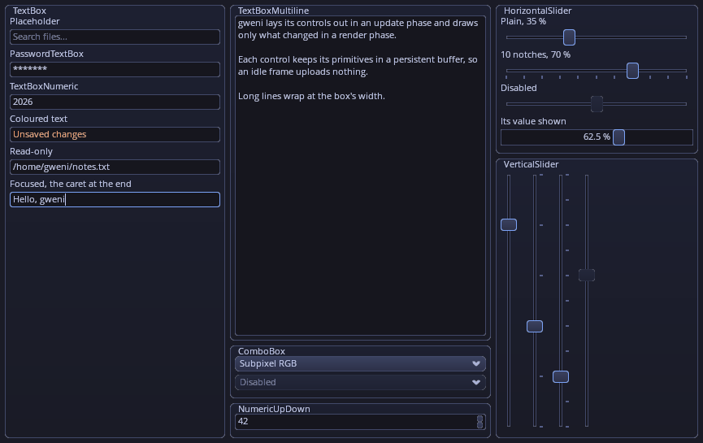](https://caseymcc.github.io/gweni/controltest.html?control=ShowcaseInputDemo)

**Text input**: TextBoxes (a placeholder, a password, a number, coloured text, read-only, one focused
with its caret), ColorEdits (R, G, B, A fields on a translucent colour over a checkerboard, a hex
field), a wrapped TextBoxMultiline, ComboBoxes, a NumericUpDown, DragNumbers (an integer and a
formatted float in 0..1, each scrubbed by dragging), a VectorField (a float3 with X, Y, Z tags), and
horizontal and vertical Sliders, plain, notched, disabled and one showing its value.

[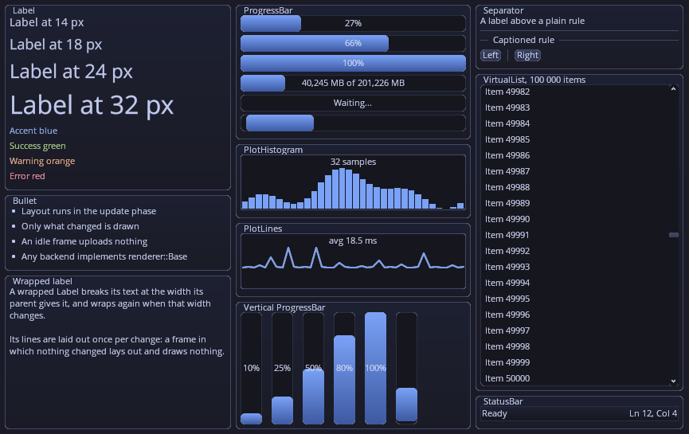](https://caseymcc.github.io/gweni/controltest.html?control=ShowcaseDisplayDemo)

**Display & feedback**: Labels from 14 to 32 px (coverage and SDF text) and in four colours, Bullets,
a wrapped Label, ProgressBars (labelled, custom text, vertical, indeterminate), a PlotHistogram of
32 bars with a caption, a PlotLines of 40 frame times with a caption, Separators (plain, captioned,
vertical), a VirtualList of 100 000 items scrolled to the middle, and a StatusBar.

[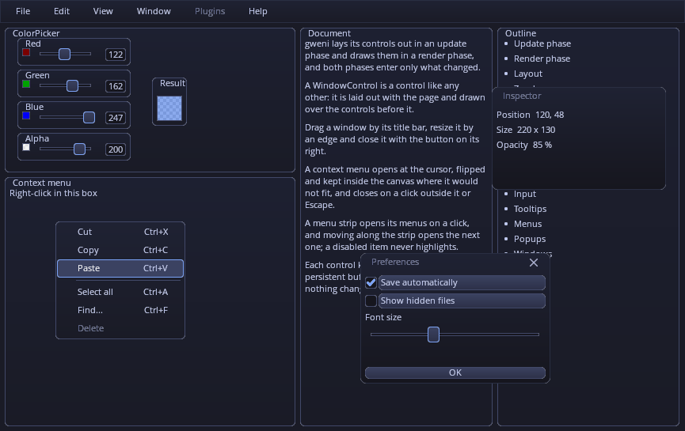](https://caseymcc.github.io/gweni/controltest.html?control=ShowcaseWindowsDemo)

**Windows & menus**: a MenuStrip with a disabled menu, a ColorPicker, a context menu opened with a
right-click (accelerators, a divider, a disabled item, one hovered), and two WindowControls over the
page's content, one with no close button.

[](https://caseymcc.github.io/gweni/controltest.html?control=TextDemo)

**Text**: OpenSans from 8 to 16 px, on the pixel grid.

[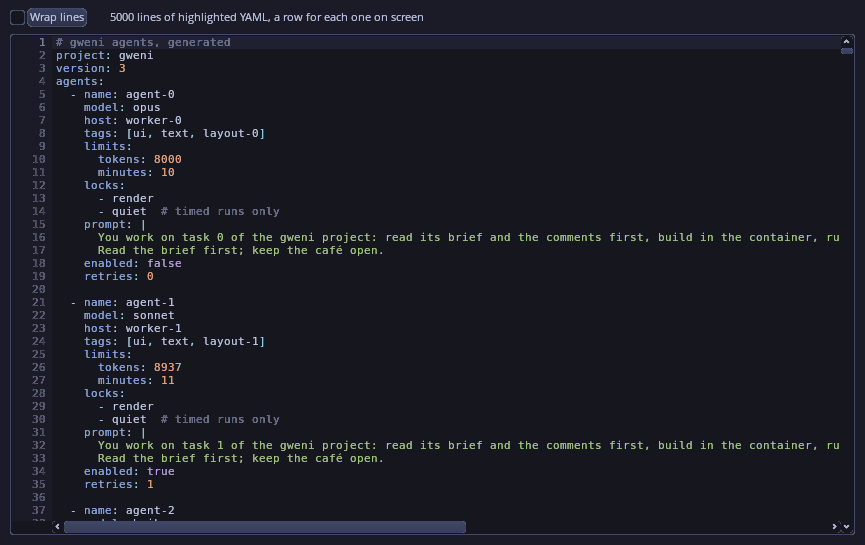](https://caseymcc.github.io/gweni/controltest.html?control=CodeEditorDemo)

**Code editor**: a CodeEditor over a 5000-line YAML document, highlighted as YAML, with line numbers:
only the lines on screen are controls, each one text run coloured by its tokens (keys, numbers,
strings, comments, block scalars). A keystroke tokenizes its line; one that opens a block scalar
re-colours the lines on screen below it and leaves the rest until they are shown.

[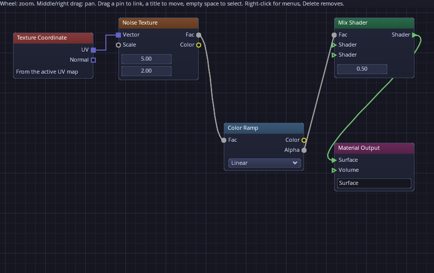](https://caseymcc.github.io/gweni/controltest.html?control=NodeGraphDemo)

**Node graph**: a NodeGraph, the node editor built on a ZoomPanel: nodes with a coloured title bar
and a body of ordinary controls (a Label, DragNumbers, a ComboBox, a TextBox), pins of three shapes
and four colours on their sides, joined by orthogonal, Bezier and straight links, over a grid that
follows the zoom. Drag a title to move a node, a pin to make a link, empty space to box-select, and
right-click for menus; dragging one node rewrites its own slots and its links' segments, nothing else.

[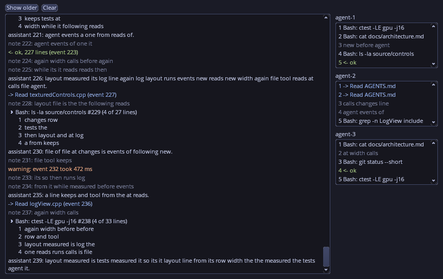](https://caseymcc.github.io/gweni/controltest.html?control=LogViewDemo)

**Log view**: a LogView, an append-only log of wrapped rows on a variable-height VirtualList, as an
agent dashboard shows a run: assistant text, tool calls and their output as collapsible blocks
("4 of 27 lines"), streamed in from the canvas clock while it follows the end, and beside it three
five-line excerpt views, each with a small cap. Scroll up and it stays put while rows arrive, with a
"Jump to latest" button counting them; click, Shift+click or drag to select rows, Ctrl+C to copy.
A frame costs the rows on screen, however long the log.

[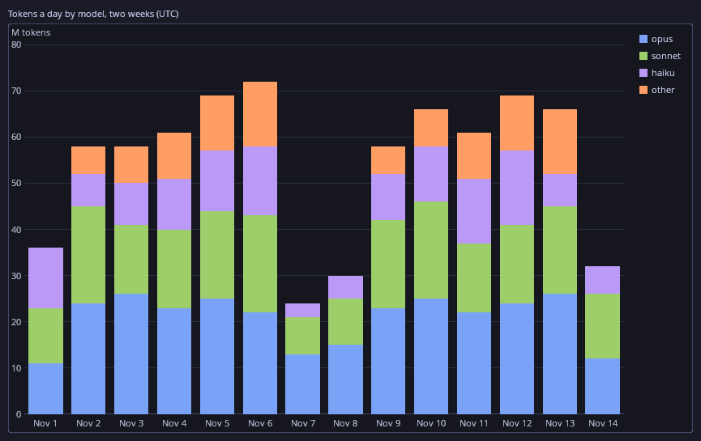](https://caseymcc.github.io/gweni/controltest.html?control=ChartTimeBarsDemo)

**Time bar chart**: a Chart of four stacked bar series over a time axis of days (one series missing
its weekends, so its x counts as 0 there), with a legend whose rows toggle their series. Every bar is a
primitive slot of the chart's renderer, not a control: a changed value rewrites the bars of its stack
alone, and an appended day its own bar.

[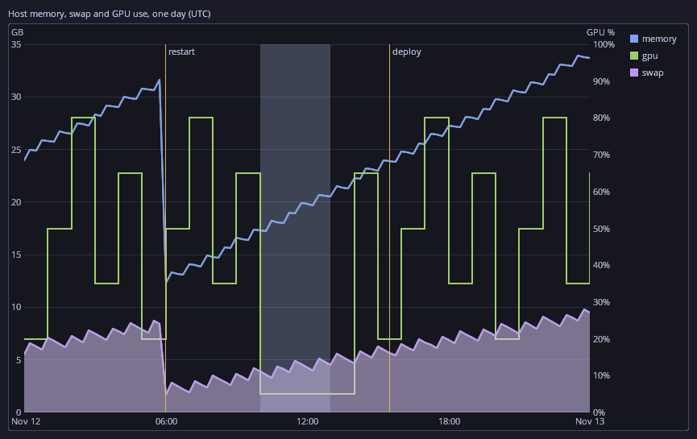](https://caseymcc.github.io/gweni/controltest.html?control=ChartLinesDemo)

**Line chart**: memory as a line and swap as an area under it on the left axis, and GPU use as a
step line on the right, over a day on a time axis pinned to UTC, with captioned marker lines and a
shaded span. Hovering draws a crosshair at the nearest x and fills the canvas's one tooltip box; a
moved point rewrites only the segments around it.

[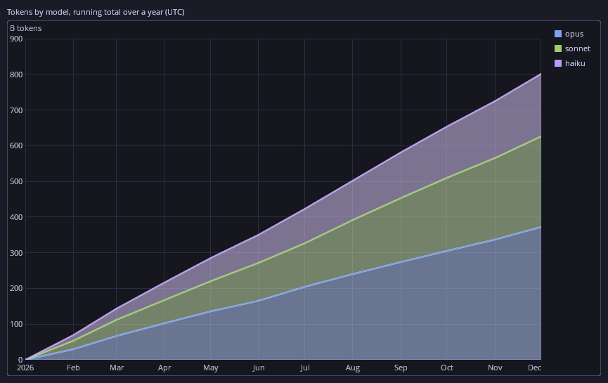](https://caseymcc.github.io/gweni/controltest.html?control=ChartAreasDemo)

**Stacked area chart**: three stacked area series of a year's running totals, month by month. Each
band is a run of trapezoids, one primitive slot per segment drawn by the renderer's style 9 (vertical
sides on whole device pixels, slanted edges anti-aliased by each pixel's exact area), from the band
below it to its line, which is drawn in front of every fill. A changed month rewrites the two
trapezoids beside it and those of the bands stacked on it, and a click inside a band picks its month.

[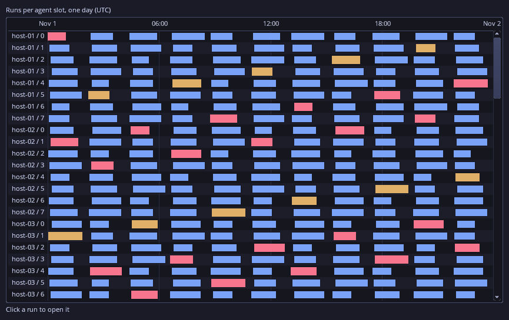](https://caseymcc.github.io/gweni/controltest.html?control=TimelineDemo)

**Timeline**: a thousand runs of one day over 96 lanes, one per agent slot of twelve hosts, on a
time axis pinned to UTC, the lanes scrolling under the fixed axis and caption column. Every bar is a
primitive slot, not a control, and the bar under the mouse is found arithmetically (the lane from y,
then a binary search of its bars): a hover writes the hover look's one slot, a changed run its own
bar, and a click hands the app the run's id.

[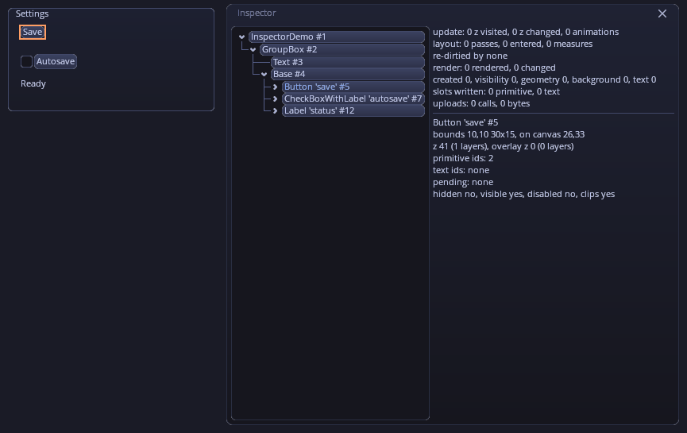](https://caseymcc.github.io/gweni/controltest.html?control=InspectorDemo)

**Inspector**: `gweni::tools::Inspector`, the library's live view of the change tracking (F12 in the
examples): the control tree, the selected control's bounds, z, ids and pending state changes, and the
last frame's counters, the app's alone. Over a settled UI it shows 0 slots written, and the frames
after it write nothing, its own included. The selected Save button is framed by its highlight box.

[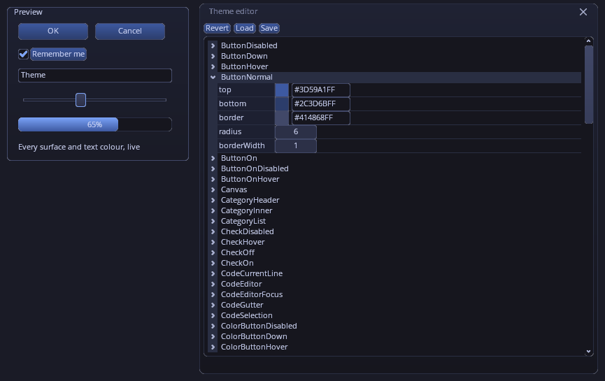](https://caseymcc.github.io/gweni/controltest.html?control=ThemeEditorDemo)

**Theme editor**: `gweni::tools::ThemeEditor`, the textured skin's theme edited live (F11 in the
examples): every surface's colours, radius and border width, and every text colour, in a PropertyTree
of ColorEdits and DragNumbers. An edit redraws the whole canvas once, and Save writes the whole theme
as the `"theme"` object `DefaultSkin.json` holds. Here ButtonNormal is edited to a deep blue, which the
buttons and the editor's own node headers show.

**Stats overlay**: `gweni::tools::StatsOverlay`, a read-only panel in the canvas's bottom-right corner
(F10 in the examples, `--stats-overlay` to open it at start-up, and open by default in the
[live demo](https://caseymcc.github.io/gweni/demo.html)): fps, each phase's time (min/avg/max), the
tree's size, the most the last frames did (controls rendered, layout passes, slots written, ...) and
plots of the cpu time and the slots per frame. Hover a row and `rendered` and `prim slots` blip and
drop back to 0, while the frame time stays flat. The mouse passes through it to the app under it.

The showcase pages, the hero's *Containers & data* among them, are in the demo shell's "Showcase"
category and in `ControlTest --control`, which also still shows every control on a page of its own
(`ControlTest --list`). All of these images are rendered
offscreen by `tools/capture_samples.sh` (see `AGENTS.md`).

## Running the examples

The examples are built in the build container (`./run_docker.sh ./generate.sh linux`, then
`./run_docker.sh cmake --build build_linux_x64_debug -j`; see `AGENTS.md` → "Building"), and
the interactive ones run on the Linux host, where there is a display. `./run.sh` runs them from
any directory:

```bash
./run.sh                                  # OpenGLCore, the interactive demo (debug build)
./run.sh -b                               # build first (through run_docker.sh), then run
./run.sh controltest --control ButtonDemo # ControlTest, one control on its own
./run.sh release controltest --list       # the release tree; asan picks the ASAN tree
./run.sh -h                               # usage; ./run.sh controltest --help is ControlTest's
```

`./run.sh [-b] [debug|release] [asan] [opengl|controltest] [args...]` passes every argument
after its own words to the exe unchanged, and runs it in your current directory, so relative
paths (`--shot`, `--screenshot`, `--resources`) are relative to where you are. Without `-b` it
never builds; if the build tree or the exe is missing it says which and how to make it.

Inside the container there is no display, so only the headless modes work there:

```bash
./run.sh controltest --headless --shot /tmp/x.png
```

`./run.sh` is a convenience only. The exes run directly from any directory too
(`build_linux_x64_debug/examples/openglcore/{OpenGLCore,ControlTest}`): by default they load the
`resources/` that the build copies next to them. `--resources <dir>` loads everything from
`<dir>` instead, e.g. `--resources resources` from the repo root to pick up live
`DefaultSkin.json` edits without a rebuild. A resource that is missing is reported on stderr
and drawn degraded instead of stopping the exe: no skin config paints every surface magenta,
no font draws the text in a built-in OpenSans. A capture (`--shot`, `--screenshot`, ...) still
writes its image and then exits 2.

To run on the host, the container-built exes need:

- glibc 2.34 or newer, and the libstdc++ of GCC 11 or newer (`GLIBCXX_3.4.29`);
- a glvnd GL driver, which provides `libGLX.so.0`, `libOpenGL.so.0` and `libEGL.so.1`.

Ubuntu 22.04+, Debian 12+ and Fedora 35+ all qualify. The vcpkg dependencies are linked
statically, so nothing else is needed. The image is built with your UID/GID, so the build
output is owned by you.

---------------------------------------

GWEN was originaly created by Garry Newman, and released under MIT License.
https://github.com/garrynewman/GWEN
