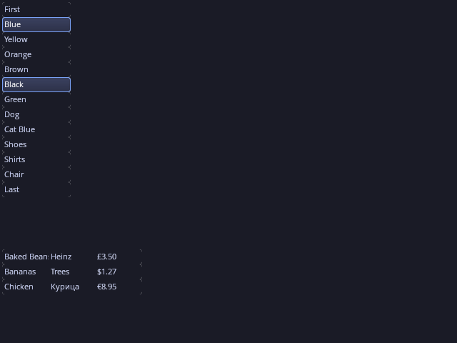
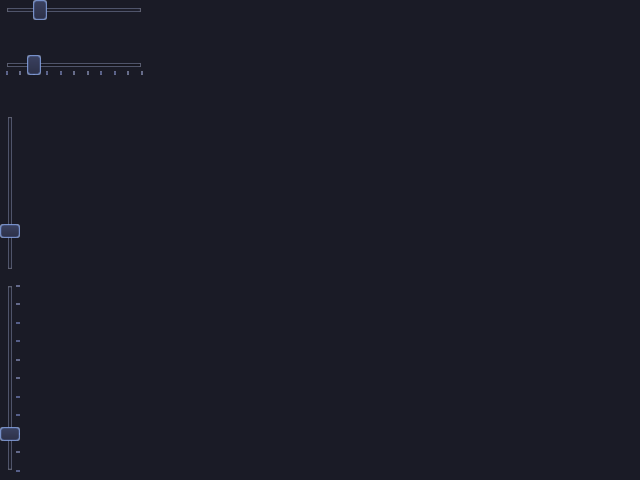
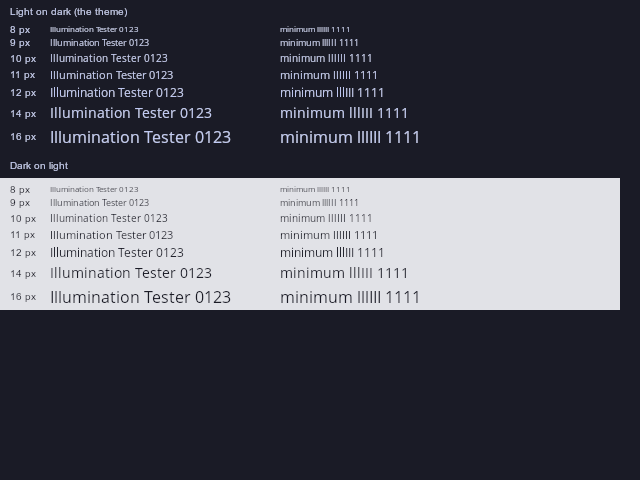
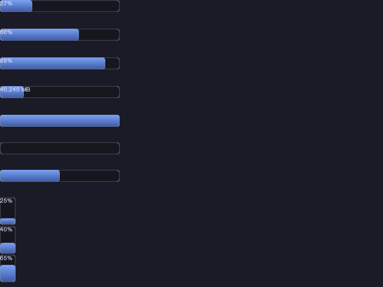

gweni - GUI Without Extravagant Nonsense (plus i for breaking changes)
---------------------

This is an attempt to make GWEN a more opengl aware ui. The expectation is to build it to provide better performance with the way modern opengl works (and later vulkan)


*The `OpenGLCore` demo on the OpenGL 3.0+ core renderer with the textured skin's Tokyo Night theme.*

## Goals

- **Rendering-API agnostic.** UI logic — layout, padding, docking, hover/highlight/focus,
  hit-testing — is decoupled from drawing. A backend just implements one interface
  (`gweni::renderer::Base`), so the same UI runs on OpenGL today and Vulkan (or others) later.
- **Two-phase frame.** `canvas->updateCanvas()` does the layout/display logic and records
  what changed; `canvas->renderCanvas()` issues only the draw-state changes needed.
- **Cost scales with change, not size.** Each control owns persistent renderer *primitive ids*
  that index into a large GPU buffer (VBO). Only primitives that changed are updated, and
  the intent is to upload just those regions to the GPU (or a larger contiguous span when
  that copy is faster), then render straight from the buffer. A simple backend may instead
  just redraw every control each frame.

See [docs/architecture.md](docs/architecture.md) for the full design and the current
implemented-vs-planned status, and [docs/layout.md](docs/layout.md) for the layout system.

## Samples

| | |
|---|---|
|  |  |
| **Button** | **RadioButton** |
|  |  |
| **TabControl** | **TreeControl** |
|  |  |
| **Properties** | **PageControl** |
|  |  |
| **ListBox** | **Slider** |
|  |  |
| **Text** (OpenSans 8-16 px) | **ProgressBar** |

Each control is shown on its own in `ControlTest`. All of these images are rendered offscreen by
`tools/capture_samples.sh` (see `AGENTS.md`).

## Running the examples

The examples are built in the build container (`./run_docker.sh ./generate.sh linux`, then
`./run_docker.sh cmake --build build_linux_x64_debug -j`; see `AGENTS.md` → "Building"), and
the interactive ones run on the Linux host, where there is a display. `./run.sh` runs them from
any directory:

```bash
./run.sh                                  # OpenGLCore, the interactive demo (debug build)
./run.sh -b                               # build first (through run_docker.sh), then run
./run.sh controltest --control ButtonDemo # ControlTest, one control on its own
./run.sh release controltest --list       # the release tree; asan picks the ASAN tree
./run.sh -h                               # usage; ./run.sh controltest --help is ControlTest's
```

`./run.sh [-b] [debug|release] [asan] [opengl|controltest] [args...]` passes every argument
after its own words to the exe unchanged, and runs it in your current directory, so relative
paths (`--shot`, `--screenshot`, `--resources`) are relative to where you are. Without `-b` it
never builds; if the build tree or the exe is missing it says which and how to make it.

Inside the container there is no display, so only the headless modes work there:

```bash
./run.sh controltest --headless --shot /tmp/x.png
```

`./run.sh` is a convenience only. The exes run directly from any directory too
(`build_linux_x64_debug/examples/openglcore/{OpenGLCore,ControlTest}`): by default they load the
`resources/` that the build copies next to them. `--resources <dir>` loads everything from
`<dir>` instead, e.g. `--resources resources` from the repo root to pick up live
`DefaultSkin.json` edits without a rebuild.

To run on the host, the container-built exes need:

- glibc 2.34 or newer, and the libstdc++ of GCC 11 or newer (`GLIBCXX_3.4.29`);
- a glvnd GL driver, which provides `libGLX.so.0`, `libOpenGL.so.0` and `libEGL.so.1`.

Ubuntu 22.04+, Debian 12+ and Fedora 35+ all qualify. The vcpkg dependencies are linked
statically, so nothing else is needed. The image is built with your UID/GID, so the build
output is owned by you.

---------------------------------------

GWEN was originaly created by Garry Newman, and released under MIT License.
https://github.com/garrynewman/GWEN